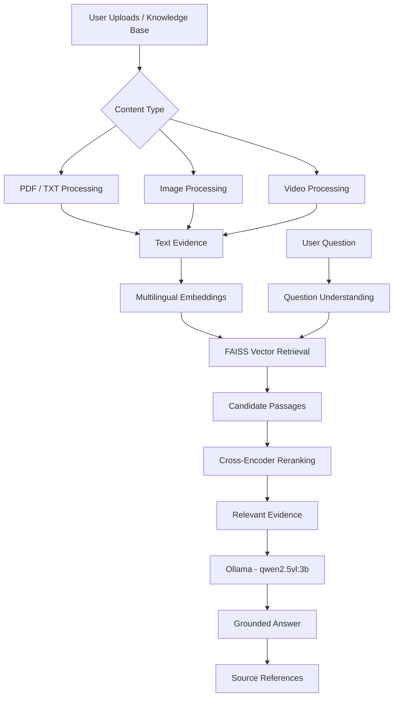

# AetherMind AI — Multimodal Knowledge Assistant

**A local, evidence-grounded Multimodal Retrieval-Augmented Generation (RAG) application for interacting with documents, images, and videos through natural language.**

AetherMind AI combines multilingual semantic embeddings, FAISS vector search, Cross-Encoder reranking, and locally hosted vision-language model inference to retrieve relevant information and generate context-aware answers with source references.

The application is built with **Streamlit, Python, FAISS, Sentence Transformers, and Ollama**, with an emphasis on local processing, evidence-based responses, and preserving the integrity of the persistent knowledge base.

---

## Overview

Traditional document-based RAG systems primarily focus on text. AetherMind AI extends this workflow to multiple content types, allowing users to work with information from uploaded PDFs, text files, images, and videos.

Its retrieval pipeline identifies relevant evidence, reranks candidate passages, and supplies the selected context to a locally running language model.

### Key Features

- **Multimodal ingestion:** Process PDF, TXT, image, and video content.
- **Multilingual semantic search:** Generate embeddings using a multilingual Sentence Transformer.
- **FAISS vector retrieval:** Retrieve semantically relevant passages efficiently.
- **Cross-Encoder reranking:** Improve retrieval relevance by reranking candidate results.
- **Local AI inference:** Generate responses using Ollama and `qwen2.5vl:3b`.
- **Evidence-based responses:** Include source references to help users trace generated answers.
- **Session-based uploads:** Process uploaded content within the active application session.
- **Persistent knowledge base:** Keep the existing FAISS index separate from temporary session uploads.
- **Local-first architecture:** Run model inference through a locally hosted Ollama service.

---

## System Architecture



### Retrieval and Generation Workflow

1. **Content ingestion:** Documents, images, and videos are processed through their respective ingestion workflows.
2. **Evidence extraction:** Textual content, image descriptions, video transcripts, and frame descriptions are prepared for retrieval.
3. **Embedding generation:** Extracted evidence is converted into multilingual semantic vector representations.
4. **Vector retrieval:** FAISS searches for candidate passages relevant to the user's question.
5. **Reranking:** A Cross-Encoder evaluates and reranks the retrieved candidates.
6. **Answer generation:** Relevant evidence is passed to the locally hosted Ollama model.
7. **Source attribution:** Generated claims are associated with retrieved source information.

---

## Technology Stack

| Component | Technology |
|---|---|
| User Interface | Streamlit |
| Programming Language | Python |
| Embedding Model | `paraphrase-multilingual-MiniLM-L12-v2` |
| Vector Database | FAISS |
| Reranking | Sentence Transformers Cross-Encoder |
| LLM Runtime | Ollama |
| Vision-Language Model | `qwen2.5vl:3b` |
| Document Processing | LangChain, PyPDF |
| Video Processing | Faster-Whisper, PyAV |
| Image Processing | Pillow |
| Containerization | Docker |

---

## Project Structure

```text
AetherMind_AI/
│
├── app.py
├── backend.py
├── requirements.txt
├── Dockerfile
├── .dockerignore
│
├── src/
│   └── multimodal_rag/
│       ├── core/
│       ├── ingestion/
│       ├── retrieval/
│       └── ...
│
├── styles/
│   └── main.css
│
├── .streamlit/
│   └── config.toml
│
├── indexes/
│   └── multimodal_rag_faiss/
│
├── memory/
│
└── README.md
```

*The structure above highlights the main project components. Some runtime data directories are intentionally excluded from version control.*

---

## Installation and Local Setup

### Prerequisites

- Python 3.11
- Git
- Ollama
- A compatible FAISS knowledge-base index

### 1. Clone the repository

```bash
git clone https://github.com/syedziaulhaq980/AetherMind_AI.git
cd AetherMind_AI
```

### 2. Create a virtual environment

```bash
python -m venv .venv
```

Activate it on Windows PowerShell:

```powershell
.\.venv\Scripts\Activate.ps1
```

### 3. Install dependencies

```bash
python -m pip install --upgrade pip
pip install -r requirements.txt
```

### 4. Install and configure Ollama

Download Ollama:

https://ollama.com/

Pull the vision-language model:

```bash
ollama pull qwen2.5vl:3b
```

Ensure Ollama is running and accessible before starting the application.

### 5. Provide the FAISS knowledge base

Place a compatible index in:

```text
indexes/multimodal_rag_faiss/
```

The persistent FAISS index is not included in this repository. You must provide a compatible index or build one using the project's ingestion workflow.

### 6. Run the application

```bash
streamlit run app.py
```

Open the local application at:

```text
http://localhost:8501
```

---

## Docker Deployment

AetherMind AI supports containerized deployment using Docker.

### 1. Build the Docker image

From the project root:

```bash
docker build -t multimodal-rag-local:latest .
```

### 2. Run the container

The following example assumes Ollama runs on the Windows host and the FAISS index and conversation memory are mounted from the project directory.

**Windows PowerShell:**

```powershell
$projectPath = (Get-Location).Path.Replace('\','/')

docker run -d `
  --name aethermind-ai `
  -p 8503:8501 `
  -e OLLAMA_BASE_URL=http://host.docker.internal:11434 `
  --mount "type=bind,source=$projectPath/indexes,target=/app/indexes,readonly" `
  --mount "type=bind,source=$projectPath/memory,target=/app/memory" `
  multimodal-rag-local:latest
```

### 3. Access the application

```text
http://localhost:8503
```

### Docker Notes

- The application runs inside the Docker container.
- Ollama runs separately on the host machine.
- `host.docker.internal` allows the container to communicate with the host Ollama service.
- The FAISS index is mounted read-only to protect persistent knowledge-base data.
- The memory directory is mounted separately for persistence.
- The Docker image does not contain the persistent FAISS index or local conversation-memory files.

**Docker Hub:** A public image link will be added after the image is published to a registry.

---

## Retrieval Evaluation

A retrieval evaluation workflow was used to assess how effectively the system retrieves relevant passages and source documents.

The evaluation includes:

- Precision@5 and Precision@8
- Recall@5
- Mean Reciprocal Rank (MRR@5 and MRR@8)

### Passage-Level Results

| Metric | Preliminary Result |
|---|---:|
| Macro Passage Precision@5 | 0.85 |
| Macro Passage Precision@8 | 0.7812 |
| Macro Passage MRR@8 | 1.00 |

### Source-Level Results

| Metric | Preliminary Result |
|---|---:|
| Source Precision@5 | 0.50 |
| Source Recall@5 | 0.8667 |
| Source MRR@5 | 1.00 |

### Evaluation Context

These are preliminary, manually judged retrieval results based on:

- 4 answerable test cases
- 34 knowledge-base sources
- 2,149 FAISS vectors

The evaluation set is currently small. These measurements assess retrieval behavior and should not be interpreted as a comprehensive evaluation of end-to-end answer quality.

**Answer-generation quality has not yet been independently benchmarked.**

---

## Privacy and Data Handling

AetherMind AI follows a local-first processing approach.

- Uploaded content is processed within the active application session.
- Session uploads do not modify the persistent FAISS knowledge base.
- The persistent FAISS index is maintained separately from temporary uploaded content.
- Local conversation-memory files and knowledge-base data are excluded from the repository.
- LLM inference is performed through a locally running Ollama service.
- Docker deployment keeps the knowledge-base index outside the application image.

---

## Current Scope and Limitations

- A compatible FAISS index must be supplied separately.
- Ollama must be installed and running for local inference.
- Retrieval evaluation currently uses a small manually judged dataset.
- End-to-end answer correctness, completeness, and grounding require further independent evaluation.
- Model performance depends on available system resources and the selected local model.

---

## Future Improvements

- Expand the retrieval evaluation dataset.
- Improve multimodal evidence selection and orchestration.
- Strengthen answer-grounding and citation validation.
- Evaluate answer correctness, completeness, and relevance independently.
- Extend support for additional media sources and formats.
- Improve inference efficiency and deployment scalability.

---

## Author

**Syed Ziaul Haq**

AI & ML | Python | NLP | Generative AI | Multimodal RAG

GitHub: https://github.com/syedziaulhaq980

---

*Built as a hands-on project exploring local AI inference, semantic retrieval, multimodal knowledge processing, and evidence-grounded question answering.*
